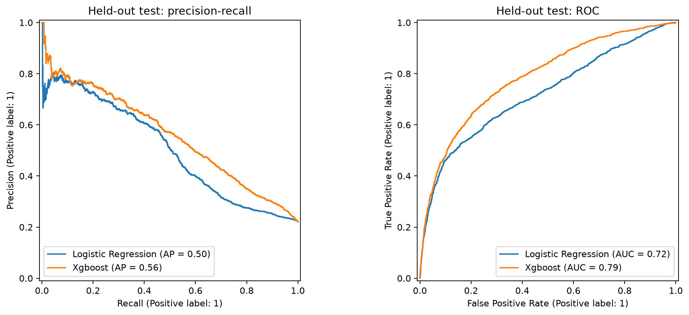

# AI-Powered Credit Risk & Loan Default Prediction

An end-to-end, reproducible analysis of the UCI **Default of Credit Card Clients**
dataset: validated ingestion, exploratory analysis, leakage-safe model comparison,
threshold trade-offs, SHAP explanations, SQL analysis, a Streamlit dashboard, and tests.

> **Scope:** This is an educational portfolio project, not a production lending system.
> It predicts next-month credit-card payment default in one historical dataset; it does
> not estimate general loan default, expected loss, or creditworthiness.

## Quick start

The repository is configured for Python 3.12. `uv` creates the environment and, when
needed, downloads the correct Python version automatically. The checked-in `Makefile`
keeps uv's cache, managed Python, and Jupyter settings inside this project for a
self-contained setup. Install `uv` first if needed: <https://docs.astral.sh/uv/>.
On macOS, XGBoost also needs the OpenMP runtime (`brew install libomp`).

```bash
cd ai-credit-risk
make setup
make all
```

Start JupyterLab:

```bash
make notebook
```

Start the dashboard:

```bash
make dashboard
```

Run quality checks:

```bash
make check
```

If `~/.local/bin` is on your `PATH`, the shorter `uv ...` form works for every command.
The dashboard opens at <http://127.0.0.1:8501>. Jupyter prints a local URL containing
its authentication token; paste that URL into your browser and select either notebook.
Keep the launching terminal open while using either application.

The commands above work from the repository root on macOS/Linux. On Windows, use WSL
or the equivalent `uv` commands with Python 3.12.

## Final benchmark results

The final evaluation groups identical feature profiles into one partition, preventing
repeated profiles from appearing in both fitting and evaluation data. Seed 42 yields
17,999 training rows, 6,001 validation rows, and 6,000 test rows. Model settings were
fixed in code; this project does not conduct an exhaustive hyperparameter search.

| Model | Test PR-AUC (average precision) ↑ | Test ROC-AUC ↑ | Brier score ↓ |
| --- | ---: | ---: | ---: |
| Constant training-prevalence baseline | 0.221 | 0.500 | 0.172 |
| Logistic regression | 0.503 | 0.721 | 0.206 |
| XGBoost | **0.559** | **0.787** | 0.175 |

XGBoost is selected using validation average precision (0.571). Its validation-selected
threshold of **0.39** achieves **76.3% recall** and **38.1% precision** on the final test
set: 1,013 true positives, 314 false negatives, 1,646 false positives, and 3,027 true negatives.

Ranking performance exceeds the constant baseline, but Brier score does not. Class-weighted
outputs are not calibrated probabilities of default; a displayed score of 0.39 must not be
read as a verified 39% chance of default. Calibration is an explicit future requirement.



Full metrics are in [reports/model_metrics.json](reports/model_metrics.json), and the
[model card](docs/MODEL_CARD.md) describes assumptions and limitations.

## What the workflow does

1. Downloads UCI dataset 350 from the official archive.
2. Verifies the archive against a pinned SHA-256 digest, validates its contents, and
   records source, DOI, license, timestamp, checksum, and cleaning decisions.
3. Converts the workbook into a clean CSV with explicit month names.
4. Creates deterministic, approximately stratified **60% train / 20% validation / 20% test**
   partitions, keeping identical feature profiles together.
5. Fits all imputation, one-hot encoding, and scaling inside scikit-learn pipelines on
   training data only. `ID` and the outcome are never model features.
6. Compares class-weighted logistic regression and XGBoost using validation PR-AUC.
7. Selects a decision threshold on validation data only, using an explicit illustrative
   false-negative:false-positive cost ratio of 5:1.
8. Evaluates the locked candidates once on the untouched test set with PR-AUC, ROC-AUC,
   Brier score, precision, recall, F1, specificity, and confusion-matrix counts.
9. Produces XGBoost SHAP explanations, descriptive group audits, saved test predictions,
   SQLite aggregate analysis, and dashboard-ready artifacts.

The 5:1 cost ratio is a scenario, not a claim about real lending economics. Change it only
with documented business, consumer-impact, and regulatory input, then validate on fresh data.

## Repository layout

```text
ai-credit-risk/
├── dashboard/app.py              # Streamlit portfolio and model dashboard
├── data/                          # downloaded/generated data (git-ignored)
├── models/                        # fitted pipelines (git-ignored)
├── notebooks/
│   ├── 01_eda.ipynb
│   └── 02_model_evaluation.ipynb
├── docs/                          # model card, data dictionary, verification record
├── reports/                       # aggregate metrics, explanations, audits, SQL outputs
├── sql/analysis.sql               # named, reusable SQLite queries
├── src/credit_risk/               # ingestion, features, modeling, SQL, CLI
├── tests/                         # schema, split, threshold, and SQL tests
├── requirements*.txt              # hash-pinned runtime/development exports
├── .github/workflows/ci.yml        # checks, pipeline, and notebooks on GitHub
├── pyproject.toml                 # project and development dependencies
└── uv.lock                        # exact resolved environment
```

Downloaded data, trained models, split manifests, and row-level test predictions are excluded
from Git. Aggregate reports, plots, and executed notebooks are versioned so a GitHub visitor
can inspect the results immediately. `make all` recreates all local artifacts.

`uv.lock` is the authoritative dependency lock. `requirements.txt` contains runtime packages;
`requirements-dev.txt` also includes Jupyter and test tools. Regenerate both with
`make requirements`. For a pip-only environment, install Python 3.12, run
`python -m pip install --require-hashes -r requirements-dev.txt`, then
`python -m pip install --no-deps -e .`. The Makefile and uv are the recommended path.

## Data and provenance

- **Dataset:** Default of Credit Card Clients (30,000 rows)
- **Creator:** I-Cheng Yeh
- **Population:** Taiwanese credit-card clients observed in 2005
- **Target:** default payment in the following month (`1` = default)
- **Source DOI:** <https://doi.org/10.24432/C55S3H>
- **License:** CC BY 4.0 (the repository's source code is MIT licensed)

The loader pins the current UCI archive checksum. If UCI legitimately changes the archive,
the workflow stops instead of silently training on different bytes. Inspect the upstream
change and provenance first; only then use:

```bash
uv run credit-risk download --force --allow-upstream-change
```

Source quirks are handled explicitly:

- UCI's `PAY_0` is renamed `PAY_SEPT`; all month-indexed fields use clear month names.
- Undocumented education codes `0`, `5`, and `6` are grouped into `OTHER` (`4`).
- Undocumented marriage code `0` is grouped into `OTHER` (`3`).
- Repayment status values `-2` and `0` occur in the source even though the short UCI
  description emphasizes `-1` and positive delay values. They are retained, not guessed away.

## Leakage controls and evaluation design

The test set is isolated before modeling. Candidate selection and threshold selection use only
the validation set. Preprocessors live inside each fitted pipeline, so medians, scaling
parameters, and one-hot vocabularies are learned from training rows only. There is no SMOTE or
resampling before the split. XGBoost's class weight is calculated from the training outcome only.

The cleaned data have 56 repeated feature profiles (35 repeated full rows when ID is excluded).
Groups are defined from the 23 model features, without using the target. A shuffled
five-fold `StratifiedGroupKFold` reserves its first fold for test; another four-fold grouped
split on the remaining data reserves its first fold for validation. No folds are searched
for a favorable score. Exact feature matches cannot cross partitions, even if their labels
differ. `reports/split_manifest.csv` records the local ID-to-partition assignment; it is
excluded from Git. The tests check partition reproducibility, group separation, and that
holdout values never change learned preprocessing statistics.

PR-AUC is the primary comparison metric because defaults are the minority class and precision-
recall behavior is more decision-relevant than accuracy. ROC-AUC is included for ranking context;
the Brier score is included because model probabilities matter. Class weighting means probability
calibration should be rechecked—and likely recalibrated—before any probability is interpreted
operationally.
Here, “PR-AUC” specifically means scikit-learn's **average precision**, not trapezoidal
integration of a precision-recall curve. Threshold selection scans 0.05 through 0.95 in
increments of 0.01. No test metrics are used to select the model or threshold.

This is a random same-population holdout because the public dataset has no row-level application
date suitable for a temporal split. It therefore does **not** test out-of-time stability.

## SQL analysis

`sql/analysis.sql` contains named aggregate queries for:

- portfolio summary;
- September repayment-status risk;
- credit-limit bands;
- age bands; and
- number of delinquent months.

`uv run credit-risk sql` loads the clean data into a local SQLite database and exports each query
to `reports/sql/*.csv`.

## Responsible-use and fairness limitations

- **Old, narrow sample:** 2005 Taiwan credit-card behavior is not representative of current
  borrowers, other countries, other products, or different economic cycles.
- **Outcome mismatch:** Payment default next month is a proxy outcome, not loss given default,
  affordability, fraud, or a universal measure of credit risk.
- **Selection and label bias:** The dataset contains already-approved customers. It excludes
  rejected applicants and inherits the lender's historical policies and measurement choices.
- **Sensitive attributes and proxies:** `SEX`, `AGE`, `EDUCATION`, and `MARRIAGE` are sensitive,
  protected in some jurisdictions, or likely proxies. They are retained for transparent research
  and group auditing—not as a recommendation for production underwriting.
- **Crude categories:** Binary sex coding and coarse education/marriage categories are dated,
  exclusionary, and insufficient for modern identity or fairness analysis.
- **Fairness audit limits:** The dashboard reports group prevalence, selection, TPR, FPR, and
  precision on one held-out sample. Gaps do not identify their cause, establish legal compliance,
  or prove fairness. Intersectional groups, uncertainty intervals, sample-size checks, and local
  legal definitions would be necessary.
- **Explanations are not causes:** SHAP values explain model behavior conditional on the fitted
  model and observed data. They do not show why a person defaulted or make a feature lawful to use.
- **No production controls:** This project lacks external validation, temporal backtesting,
  calibration governance, adverse-action validation, human review workflows, drift monitoring,
  security controls, appeals, and jurisdiction-specific compliance review.

Do not use this model to approve, deny, price, or market credit. A real system needs domain,
consumer-protection, fairness, legal, privacy, security, and model-risk governance from the start.

## Reproducing notebooks

After running the full workflow, launch JupyterLab and open the two notebooks. To execute them
non-interactively:

```bash
make notebooks
```

## Verification and GitHub

The local verification record is in [docs/VERIFICATION.md](docs/VERIFICATION.md). The
GitHub Actions workflow repeats environment installation, code checks, tests, the full
pipeline, dashboard artifact tests, and notebook execution on pushes and pull requests.
View the latest status in [GitHub Actions](https://github.com/akhilesh02010/ai-credit-risk/actions).

The repository is hosted at [akhilesh02010/ai-credit-risk](https://github.com/akhilesh02010/ai-credit-risk)
and uses branch `main`. It was created as private. The local checkout uses a GitHub
no-reply commit email, and GitHub CLI keeps authentication in the macOS keychain.
No authentication credentials are included in the project files. The Makefile's
analysis commands do not publish anything; Git pushes are separate, explicit actions.

On this Mac, `uv` is installed at `/Users/akhileshpandey/.local/bin/uv`. The native OpenMP
runtime is libomp 18.1.8 from the official Homebrew Apple Silicon Ventura bottle, installed
at `/opt/homebrew/opt/libomp`. Its verified archive SHA-256 is
`dce27dc860127be3aa739a30496efe474f80ee7c8927d26ac7e3985f45a2f46b`.
It was installed directly because this machine's older Homebrew could not parse the current
build dependencies. Native OpenMP is outside uv's lock; other Macs should install their
supported `libomp` through Homebrew.

## Future improvements

- Obtain a dated, consented, representative dataset and run out-of-time validation.
- Add probability calibration and calibration curves on a separate calibration sample.
- Quantify uncertainty with bootstrap confidence intervals and repeat splits.
- Define costs and constraints with affected stakeholders instead of an illustrative ratio.
- Test reduced-feature models that exclude sensitive attributes and likely proxies.
- Add robust intersectional fairness analysis and governance-ready model documentation.
